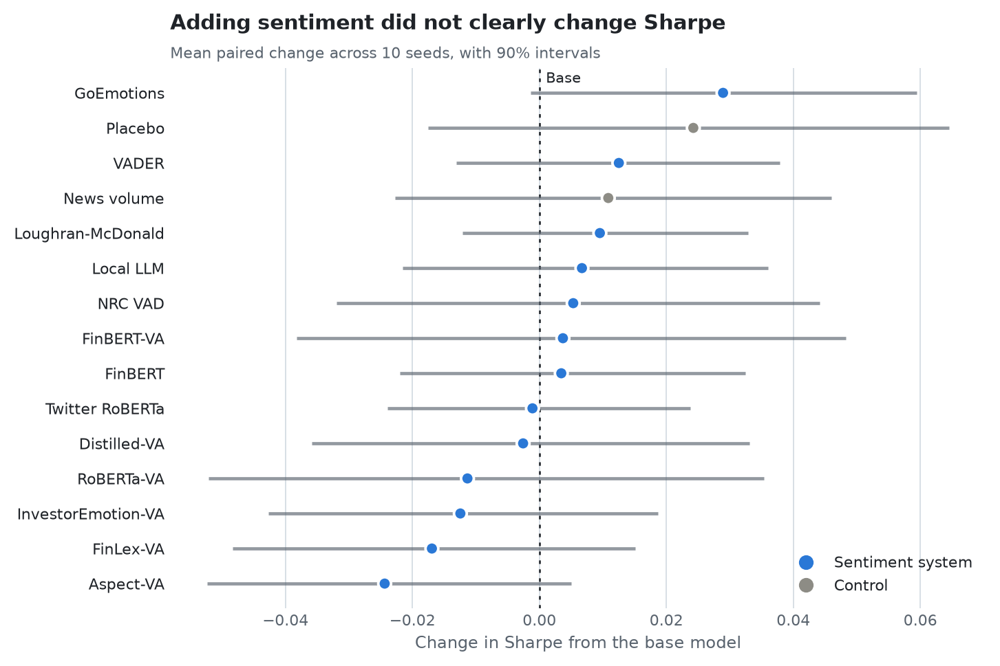
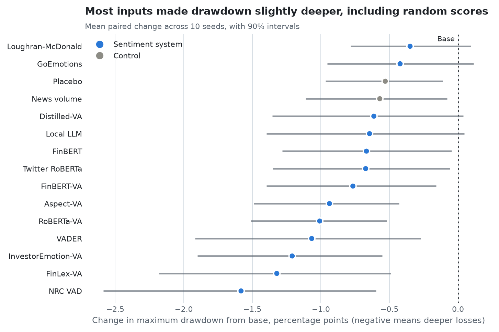
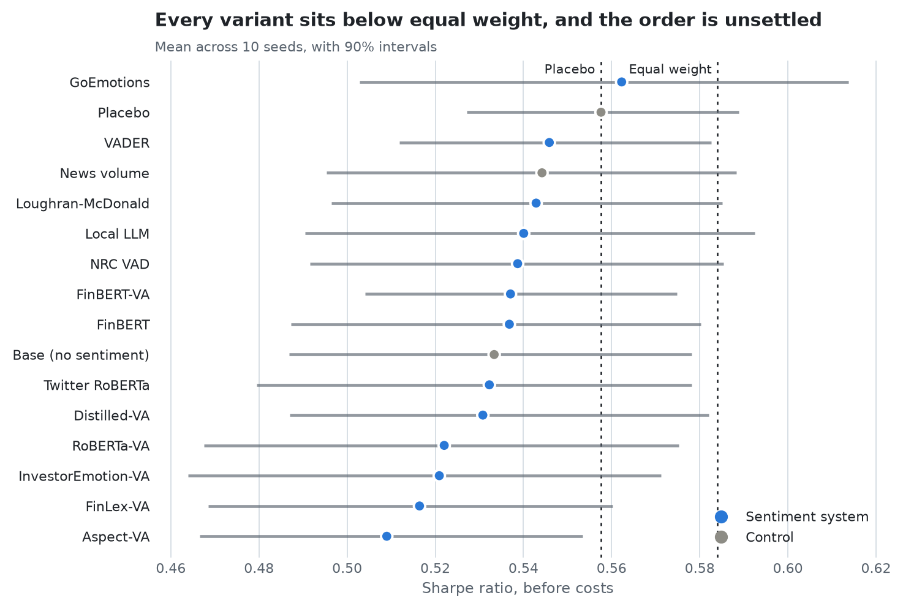
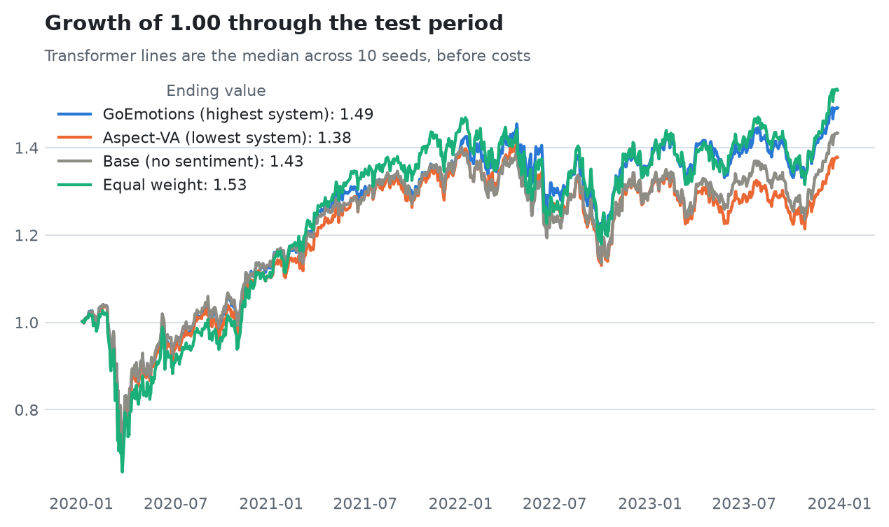
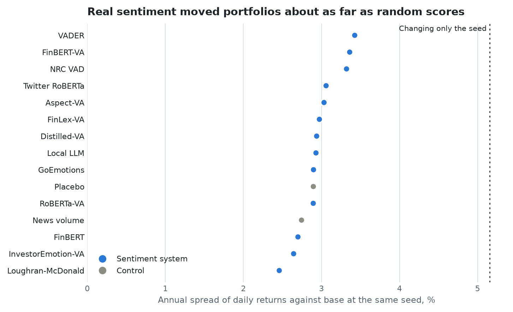
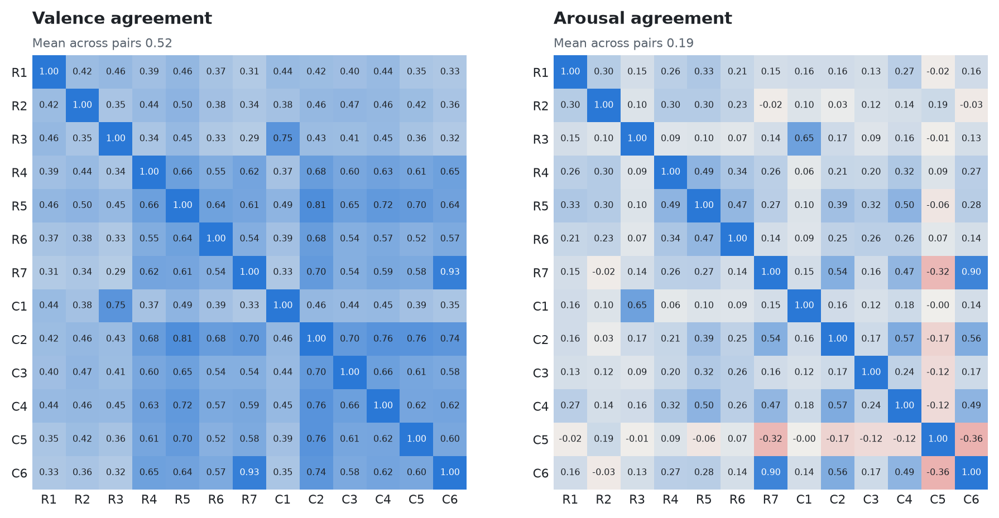
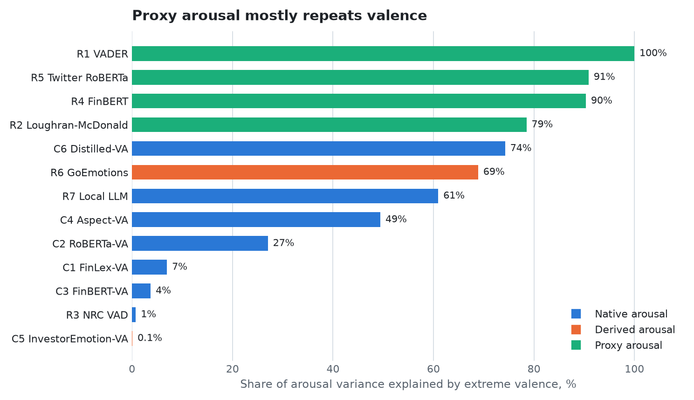
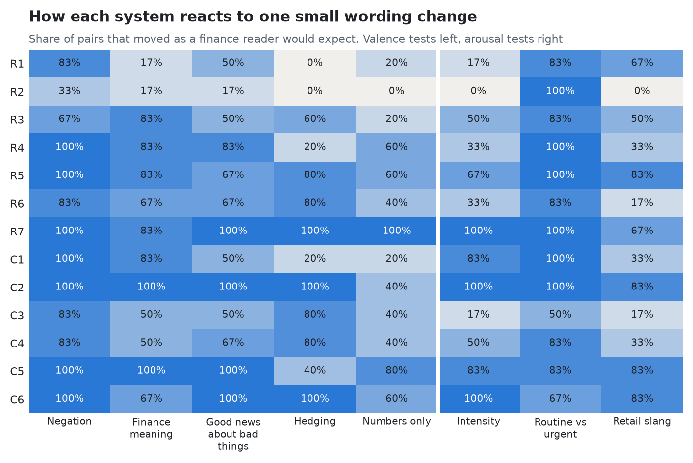

# Sentiment Systems in a Transformer Portfolio

Performance results for the honors capstone "Integrating Valence-Arousal Sentiment Models into Transformer Based Portfolio Optimization". Thirteen sentiment systems each ran through the same transformer portfolio model on identical inputs, with 10 seeds each. The test period is January 2020 to December 2023.

**Adding sentiment did not clearly improve the base transformer.** Sharpe went up for 7 systems and down for 6, and none of those changes is larger than seed noise. For the full write-up, see [summary.md](summary.md).

| Sentiment systems | Portfolio runs | Clearly better than base on Sharpe | Clearly worse than base on Sharpe | Base Sharpe | Highest system | Equal weight |
|---|---|---|---|---|---|---|
| 13 | 160 | 0 | 0 | 0.533 | 0.562 (GoEmotions) | 0.584 |

## Did sentiment beat the base model?

Base is the same transformer with sentiment switched off. Each row adds one input to it, and the two are compared seed by seed.

<picture>
  <source media="(prefers-color-scheme: dark)" srcset="charts/base-sharpe-dark.png">
  
</picture>

| Input | Sharpe | Change from base | Seeds better | Sharpe result | Drawdown result | Final wealth result |
|---|---|---|---|---|---|---|
| R6 GoEmotions | 0.562 | +0.029 | 7 of 10 | Up, noise | Down, noise | **Better** |
| B2 Placebo | 0.558 | +0.024 | 7 of 10 | Up, noise | **Worse** | Up, noise |
| R1 VADER | 0.546 | +0.013 | 7 of 10 | Up, noise | **Worse** | Up, noise |
| B1 News volume | 0.544 | +0.011 | 6 of 10 | Up, noise | **Worse** | Up, noise |
| R2 Loughran-McDonald | 0.543 | +0.010 | 5 of 10 | Up, noise | Down, noise | Up, noise |
| R7 Local LLM | 0.540 | +0.007 | 4 of 10 | Up, noise | Down, noise | Up, noise |
| R3 NRC VAD | 0.539 | +0.005 | 5 of 10 | Up, noise | **Worse** | Up, noise |
| C3 FinBERT-VA | 0.537 | +0.004 | 5 of 10 | Up, noise | **Worse** | Up, noise |
| R4 FinBERT | 0.537 | +0.003 | 4 of 10 | Up, noise | **Worse** | Up, noise |
| R5 Twitter RoBERTa | 0.532 | -0.001 | 5 of 10 | Down, noise | **Worse** | Up, noise |
| C6 Distilled-VA | 0.531 | -0.003 | 4 of 10 | Down, noise | Down, noise | Up, noise |
| C2 RoBERTa-VA | 0.522 | -0.011 | 3 of 10 | Down, noise | **Worse** | Down, noise |
| C5 InvestorEmotion-VA | 0.521 | -0.012 | 4 of 10 | Down, noise | **Worse** | Down, noise |
| C1 FinLex-VA | 0.516 | -0.017 | 4 of 10 | Down, noise | **Worse** | Down, noise |
| C4 Aspect-VA | 0.509 | -0.024 | 2 of 10 | Down, noise | **Worse** | Down, noise |

Base Sharpe is 0.533. "Better" and "Worse" mean the 90% interval clears zero. "Up, noise" and "Down, noise" give the direction when it does not.

<picture>
  <source media="(prefers-color-scheme: dark)" srcset="charts/base-drawdown-dark.png">
  
</picture>

## Ranking

<picture>
  <source media="(prefers-color-scheme: dark)" srcset="charts/ranking-dark.png">
  
</picture>

| Rank | Variant | Sharpe | Possible ranks | Final wealth | Max drawdown | Sharpe after costs | Against placebo |
|---|---|---|---|---|---|---|---|
| 1 | R6 GoEmotions | 0.562 | 1 to 8 | 1.471 | 32.5% | 0.534 | Not separable |
| 2 | B2 Placebo | 0.558 | 1 to 11 | 1.459 | 32.6% | 0.531 | Control |
| 3 | R1 VADER | 0.546 | 3 to 8 | 1.448 | 33.1% | 0.515 | Not separable |
| 4 | B1 News volume | 0.544 | 2 to 12 | 1.446 | 32.6% | 0.518 | Not separable |
| 5 | R2 Loughran-McDonald | 0.543 | 2 to 10 | 1.443 | 32.4% | 0.516 | Not separable |
| 6 | R7 Local LLM | 0.540 | 2 to 13 | 1.443 | 32.7% | 0.513 | Not separable |
| 7 | R3 NRC VAD | 0.539 | 1 to 13 | 1.443 | 33.7% | 0.510 | Not separable |
| 8 | C3 FinBERT-VA | 0.537 | 1 to 15 | 1.437 | 32.8% | 0.509 | Not separable |
| 9 | R4 FinBERT | 0.537 | 4 to 13 | 1.437 | 32.7% | 0.509 | Not separable |
| 10 | B0 Base (no sentiment) | 0.533 | 3 to 15 | 1.431 | 32.1% | 0.508 | Not separable |
| 11 | R5 Twitter RoBERTa | 0.532 | 3 to 15 | 1.431 | 32.8% | 0.506 | Not separable |
| 12 | C6 Distilled-VA | 0.531 | 3 to 15 | 1.432 | 32.7% | 0.504 | Not separable |
| 13 | C2 RoBERTa-VA | 0.522 | 3 to 16 | 1.423 | 33.1% | 0.493 | Not separable |
| 14 | C5 InvestorEmotion-VA | 0.521 | 8 to 16 | 1.422 | 33.3% | 0.493 | Not separable |
| 15 | C1 FinLex-VA | 0.516 | 9 to 16 | 1.414 | 33.4% | 0.487 | Below |
| 16 | C4 Aspect-VA | 0.509 | 13 to 16 | 1.405 | 33.0% | 0.481 | Below |

## Growth over the test period

<picture>
  <source media="(prefers-color-scheme: dark)" srcset="charts/growth-dark.png">
  
</picture>

## How far each input moved the portfolio

<picture>
  <source media="(prefers-color-scheme: dark)" srcset="charts/movement-dark.png">
  
</picture>

The model does react to sentiment, but real sentiment moved portfolios about as far as random scores did.

## How the systems differ

The systems agree much less on arousal than on valence, even though they read the same 282,306 headline rows.

<picture>
  <source media="(prefers-color-scheme: dark)" srcset="charts/agreement-dark.png">
  
</picture>

<picture>
  <source media="(prefers-color-scheme: dark)" srcset="charts/arousal-dark.png">
  
</picture>

<picture>
  <source media="(prefers-color-scheme: dark)" srcset="charts/stress-dark.png">
  
</picture>

## Files

- [summary.md](summary.md): every run, how each system differs, and how the portfolio system works.
- [results/](results/): the end values behind these charts, as tables.

This repository holds performance results only. Stock prices, news headlines, trained models and code are not stored here.
