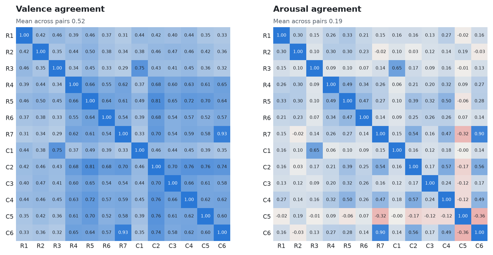
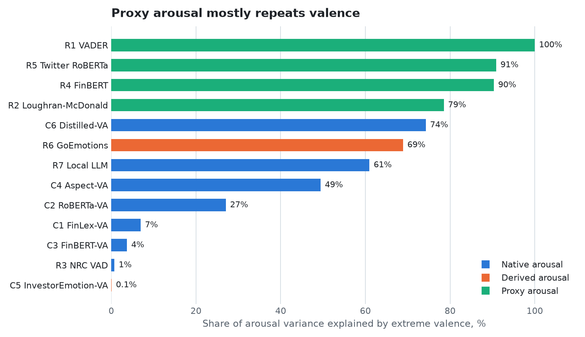
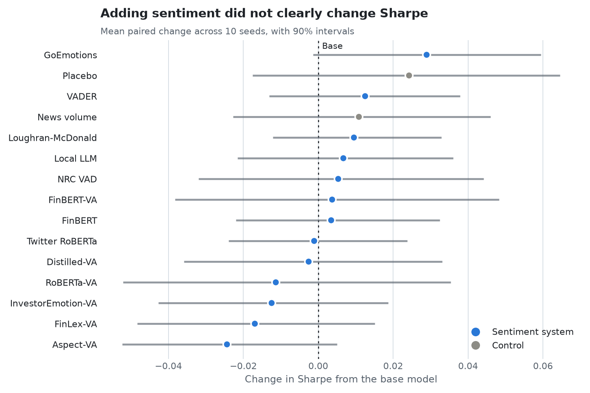

# Summary of All Runs

Honors capstone: "Integrating Valence-Arousal Sentiment Models into Transformer Based Portfolio Optimization." Sponsor: Blake Rayfield, Coggin College of Business, University of North Florida. Results as of November 2026.

The charts are on the [repository front page](README.md), and the end values are in [results/](results/).

## 1. The short version

- **Adding sentiment did not clearly improve the base transformer.** On Sharpe, 7 of 13 systems were higher than base and 6 were lower, and none of the changes is larger than seed noise. After costs the picture is the same.
- **On average, sentiment added nothing.** The mean of the 13 systems is 0.533, and base is 0.533. The paired difference is +0.000 (90% interval -0.024 to +0.026).
- **One system showed a clear gain, on three measures.** GoEmotions beat base on Sortino, annual return and final wealth. It did not separate from the random-score placebo, and with this many comparisons one such result is unsurprising.
- **Drawdown got slightly worse.** 9 of 13 systems were clearly deeper than base, by up to 1.6 percentage points. Random scores and news volume alone were also deeper, by about 0.6 points, so at least part of this comes from adding the news inputs and not from sentiment itself. VADER, InvestorEmotion-VA, FinLex-VA, NRC VAD were deeper than the placebo as well.
- **No system beat the random-score placebo** on any measure, and equal weight (0.584) beat every transformer variant on Sharpe.
- **The systems read news very differently.** Mean rank correlation between pairs of systems is 0.52 on valence and only 0.19 on arousal. Those differences did not reach portfolio performance in this setup.

## 2. What was run

| Batch | Runs | What it was |
|---|---|---|
| Sentiment scoring | 13 systems, 282,306 rows each | Every system scored the same headline table |
| Custom model training | 5 models | C2 to C6, listed in section 7 |
| Stress tests | 13 systems, 46 headline pairs | Hand-written pairs that differ in one way |
| Portfolio runs | 160 = 16 variants x 10 seeds | 13 systems and 3 controls through the same transformer, 3.9 GPU hours |
| Traditional portfolios | 5 strategies | Classic allocation methods on the same stocks and dates |
| Reproduction checks | 13 runs | The transformer alone, compared with the paper's published result |

## 3. How the sentiment systems differ

Every system returns valence (how good or bad, from -1 to 1) and arousal (how calm or intense, from 0 to 1). The main difference is how each gets there. Arousal comes in three kinds: **native** is measured directly, **derived** is mapped from emotion labels, and **proxy** is calculated from polarity strength.

R systems are off the shelf. C systems are custom and were built for this project.

### 3.1 The 13 systems

| ID | System | Method | Domain | Arousal | Built on |
|---|---|---|---|---|---|
| R1 | VADER | rule-based | social | proxy | Hand-built lexicon and rules tuned for social media |
| R2 | Loughran-McDonald | lexicon | finance | proxy | Word lists built from 10-K filings; this copy is the older edition bundled with pysentiment2 |
| R3 | NRC VAD | lexicon | general | native | Human ratings for over 55,000 English terms |
| R4 | FinBERT | classifier | finance | proxy | BERT further trained on Reuters news and fine-tuned on Financial PhraseBank |
| R5 | Twitter RoBERTa | classifier | social | proxy | RoBERTa trained on about 124M tweets, January 2018 to December 2021 |
| R6 | GoEmotions | emotion | social | derived | RoBERTa trained on GoEmotions Reddit comments; labels placed with NRC VAD |
| R7 | Local LLM | LLM | general | native | Qwen3-4B-Instruct run locally for free, zero-shot, with company names masked |
| C1 | FinLex-VA | lexicon | finance | native | NRC VAD with hand-written finance meanings, phrase rules, negation and intensifiers |
| C2 | RoBERTa-VA | regression | general | native | roberta-base with a two-output head, trained here on EmoBank |
| C3 | FinBERT-VA | regression | finance | native | finbert-pretrain with the same head and data as C2, so only the backbone differs |
| C4 | Aspect-VA | regression | finance | native | xlm-roberta-base trained here on EmoBank and DimABSA Chinese and Japanese finance labels |
| C5 | InvestorEmotion-VA | emotion | investor | derived | RoBERTa fine-tuned here on StockEmotions; labels placed with NRC VAD |
| C6 | Distilled-VA | regression | finance | native | finbert-pretrain trained here on local LLM ratings of 2016-and-earlier headlines |

### 3.2 What sets each one apart

- **R1 VADER:** Hand-built word scores and rules made for social media. Arousal is just the size of valence, so it adds nothing new. 45% of headlines score as neutral. Finance wording is a weak spot: it reacted as expected on 17% of those pairs. *Portfolio: Sharpe 0.546, +0.013 against base, moved returns 3.4% a year.*
- **R2 Loughran-McDonald:** Counts words from finance word lists built on 10-K filings. Most headlines contain no listed word, so 73% score as neutral, the most of any system. It ignores word order, which shows on negation (33%) and hedging (0%). *Portfolio: Sharpe 0.543, +0.010 against base, moved returns 2.5% a year.*
- **R3 NRC VAD:** Averages human ratings of single words, with no context. It has real arousal ratings, but averaging flattens them: arousal standard deviation is 0.07. 87% of headlines land positive. *Portfolio: Sharpe 0.539, +0.005 against base, moved returns 3.3% a year.*
- **R4 FinBERT:** BERT further trained on financial news. It has the widest valence spread (standard deviation 0.52), so it rarely sits on the fence. Arousal is 1 minus the neutral probability, so 90% of it is valence extremity. *Portfolio: Sharpe 0.537, +0.003 against base, moved returns 2.7% a year.*
- **R5 Twitter RoBERTa:** RoBERTa trained on about 124 million tweets. Despite that, it sits close to the group, with mean valence agreement of 0.61. Its tweets run through 2021, which overlaps the test period. *Portfolio: Sharpe 0.532, -0.001 against base, moved returns 3.1% a year.*
- **R6 GoEmotions:** Predicts 28 emotions learned from Reddit comments, then places them on the valence-arousal map with NRC ratings. 34% of headlines land on neutral. It has the highest mean Sharpe of the systems. *Portfolio: Sharpe 0.562, +0.029 against base, moved returns 2.9% a year.*
- **R7 Local LLM:** A general 4-billion-parameter LLM (Qwen3-4B) run locally with a rubric and company names masked. It reads headlines as mostly good news: 77% positive, mean valence +0.36. It reacted as expected on every number-only and hedging pair. It is by far the slowest at 6.5 hours, and its training data covers the test period, so it may recall outcomes. *Portfolio: Sharpe 0.540, +0.007 against base, moved returns 2.9% a year.*
- **C1 FinLex-VA:** NRC VAD plus hand-written finance meanings, phrases, negation and intensifiers. Arousal is largely separate from valence (7%). A known weakness was left untuned on purpose: phrases such as "strong dollar" read as good news, and inflected words outside its lists are missed. *Portfolio: Sharpe 0.516, -0.017 against base, moved returns 3.0% a year.*
- **C2 RoBERTa-VA:** roberta-base trained here to predict valence and arousal directly from EmoBank, which is general English. Predictions stay near the middle (valence standard deviation 0.11, arousal 0.03). It has the highest mean valence agreement with the others (0.63). *Portfolio: Sharpe 0.522, -0.011 against base, moved returns 2.9% a year.*
- **C3 FinBERT-VA:** Identical to C2 except that the backbone was pretrained on finance text, which isolates that one choice. Arousal became less tied to valence (4% against 27% for C2), but it also reacted far less on arousal tests (17% of intensity pairs against 100%). *Portfolio: Sharpe 0.537, +0.004 against base, moved returns 3.4% a year.*
- **C4 Aspect-VA:** xlm-roberta trained on EmoBank plus Chinese and Japanese finance ratings. It is the only custom model that takes the company as an input, so it can score one headline per company. Predictions stay near the middle (arousal standard deviation 0.03). It has the lowest mean Sharpe of the systems. *Portfolio: Sharpe 0.509, -0.024 against base, moved returns 3.0% a year.*
- **C5 InvestorEmotion-VA:** roberta-base trained here on 12 investor emotions from StockTwits posts, then placed on the map with NRC ratings. Its arousal disagrees with everyone (mean rank correlation -0.07) and has almost no link to valence (0.1%). Its 2020 training posts overlap the test period but carry no price labels. *Portfolio: Sharpe 0.521, -0.012 against base, moved returns 2.6% a year.*
- **C6 Distilled-VA:** A FinBERT student trained to copy R7's ratings on headlines dated 2016 or earlier. It tracks R7 closely (rank correlation 0.93 on valence, 0.90 on arousal) and scored every row in 4 minutes against R7's 6.5 hours. It never saw a rating from the test period. *Portfolio: Sharpe 0.531, -0.003 against base, moved returns 2.9% a year.*

### 3.3 Behaviour on the same headlines

| System | Mean valence | Valence spread | Mean arousal | Arousal spread | Negative | Neutral | Positive |
|---|---|---|---|---|---|---|---|
| R1 VADER | +0.11 | 0.30 | 0.22 | 0.24 | 15% | 45% | 40% |
| R2 Loughran-McDonald | -0.01 | 0.27 | 0.15 | 0.25 | 14% | 73% | 13% |
| R3 NRC VAD | +0.20 | 0.17 | 0.50 | 0.07 | 9% | 4% | 87% |
| R4 FinBERT | +0.13 | 0.52 | 0.47 | 0.36 | 25% | 10% | 65% |
| R5 Twitter RoBERTa | +0.12 | 0.35 | 0.31 | 0.24 | 22% | 7% | 71% |
| R6 GoEmotions | +0.03 | 0.14 | 0.35 | 0.06 | 12% | 34% | 54% |
| R7 Local LLM | +0.36 | 0.41 | 0.67 | 0.16 | 21% | 2% | 77% |
| C1 FinLex-VA | +0.35 | 0.30 | 0.50 | 0.13 | 10% | 7% | 83% |
| C2 RoBERTa-VA | +0.06 | 0.11 | 0.51 | 0.03 | 18% | 8% | 74% |
| C3 FinBERT-VA | +0.02 | 0.11 | 0.51 | 0.05 | 30% | 15% | 56% |
| C4 Aspect-VA | +0.04 | 0.14 | 0.54 | 0.03 | 26% | 9% | 66% |
| C5 InvestorEmotion-VA | +0.12 | 0.36 | 0.61 | 0.10 | 31% | 2% | 67% |
| C6 Distilled-VA | +0.38 | 0.40 | 0.68 | 0.15 | 19% | 2% | 79% |

Spread is the standard deviation. Neutral means a valence within 0.02 of zero.

### 3.4 Same headline, different reads

These three headlines are made up for this example. Each cell shows valence / arousal.

1. Acme fails to beat estimates as losses narrowed
2. Acme shares plunge after fatal plant explosion
3. Acme holds its annual shareholder meeting

| System | Headline 1 | Headline 2 | Headline 3 |
|---|---|---|---|
| R1 VADER | -0.67 / 0.67 | -0.32 / 0.32 | +0.00 / 0.00 |
| R2 Loughran-McDonald | -0.67 / 1.00 | +0.00 / 0.00 | +0.00 / 0.00 |
| R3 NRC VAD | -0.16 / 0.52 | -0.20 / 0.58 | +0.18 / 0.47 |
| R4 FinBERT | -0.85 / 0.97 | -0.91 / 0.94 | -0.00 / 0.05 |
| R5 Twitter RoBERTa | -0.70 / 0.73 | -0.83 / 0.85 | +0.08 / 0.11 |
| R6 GoEmotions | -0.49 / 0.45 | -0.43 / 0.37 | +0.05 / 0.34 |
| R7 Local LLM | -0.16 / 0.49 | -0.54 / 0.90 | +0.17 / 0.49 |
| C1 FinLex-VA | +0.09 / 0.46 | -0.46 / 0.73 | +0.41 / 0.60 |
| C2 RoBERTa-VA | -0.16 / 0.48 | -0.44 / 0.54 | +0.05 / 0.50 |
| C3 FinBERT-VA | -0.15 / 0.53 | -0.32 / 0.53 | +0.16 / 0.49 |
| C4 Aspect-VA | -0.28 / 0.54 | -0.34 / 0.57 | +0.12 / 0.51 |
| C5 InvestorEmotion-VA | -0.15 / 0.69 | -0.59 / 0.81 | -0.05 / 0.64 |
| C6 Distilled-VA | -0.25 / 0.52 | -0.68 / 0.81 | +0.21 / 0.53 |

### 3.5 Agreement between systems

<picture>
  <source media="(prefers-color-scheme: dark)" srcset="charts/agreement-dark.png">
  
</picture>

| Measure | Valence | Arousal |
|---|---|---|
| Mean across the 78 pairs | 0.52 | 0.19 |
| Lowest pair | 0.29 (R3, R7) | -0.36 (C5, C6) |
| Highest pair | 0.93 (R7, C6) | 0.90 (R7, C6) |

R7 and C6 are the highest pair because C6 was trained to copy R7.

### 3.6 Is arousal separate from valence?

<picture>
  <source media="(prefers-color-scheme: dark)" srcset="charts/arousal-dark.png">
  
</picture>

A low share only means the arousal score is not a copy of valence. It does not show the score is meaningful.

### 3.7 Stress tests

Each pair of headlines differs in one way, such as an added negation. The table shows how often a system moved the way a finance reader would expect. It describes behaviour and is not an accuracy score.

| System | Negation | Finance meaning | Good news about bad things | Hedging | Numbers only | Intensity | Routine vs urgent | Retail slang |
|---|---|---|---|---|---|---|---|---|
| R1 VADER | 83% | 17% | 50% | 0% | 20% | 17% | 83% | 67% |
| R2 Loughran-McDonald | 33% | 17% | 17% | 0% | 0% | 0% | 100% | 0% |
| R3 NRC VAD | 67% | 83% | 50% | 60% | 20% | 50% | 83% | 50% |
| R4 FinBERT | 100% | 83% | 83% | 20% | 60% | 33% | 100% | 33% |
| R5 Twitter RoBERTa | 100% | 83% | 67% | 80% | 60% | 67% | 100% | 83% |
| R6 GoEmotions | 83% | 67% | 67% | 80% | 40% | 33% | 83% | 17% |
| R7 Local LLM | 100% | 83% | 100% | 100% | 100% | 100% | 100% | 67% |
| C1 FinLex-VA | 100% | 83% | 50% | 20% | 20% | 83% | 100% | 33% |
| C2 RoBERTa-VA | 100% | 100% | 100% | 100% | 40% | 100% | 100% | 83% |
| C3 FinBERT-VA | 83% | 50% | 50% | 80% | 40% | 17% | 50% | 17% |
| C4 Aspect-VA | 83% | 50% | 67% | 80% | 40% | 50% | 83% | 33% |
| C5 InvestorEmotion-VA | 100% | 100% | 100% | 40% | 80% | 83% | 83% | 83% |
| C6 Distilled-VA | 100% | 67% | 100% | 100% | 60% | 100% | 67% | 83% |

The first five columns test valence and the last three test arousal.

## 4. The portfolio and trading system

### What it is

The portfolio model is the Signature-Informed Transformer (SIT) of Hwang and Zohren (ICML 2026). It is a long-only allocator: at each rebalance it sets a weight for each of 50 stocks, and the weights add up to 100%. There are no short positions and no leverage.

This project added one input to it, so each stock can carry sentiment. Nothing else in the architecture changed.

### How a decision is made

1. **Price features.** For each stock and day, a path signature summarizes the last 60 trading days: the net move and a second-order term. For each pair of stocks, a cross term captures how they move together. These are standardized with training-period statistics.
2. **Calendar and identity.** Day of week, day of month and day of year, plus an embedding for each stock.
3. **Sentiment features.** Each stock gets four channels per day: valence, arousal, news present and news volume. Stories fade with a 5-trading-day half-life and drop out after 20 trading days. Valence and arousal are standardized with each system's own 2016-and-earlier statistics, so no system gets a bigger input from its native scale.
4. **Transformer.** The four inputs are joined into one token per stock per day. Two layers with 8 heads attend across time with a causal mask, then across stocks, and the cross terms bias that attention. The model is deliberately small, with a width of 8.
5. **Weights.** Each stock gets a score, and a softmax with temperature 1.3 turns the scores into weights.
6. **Trades.** The portfolio moves to the target weights on each of the 51 rebalance dates in the test period, about every 20 trading days. It holds those weights until the next one.

### How it is trained

The model is trained directly on portfolio outcomes, not on price forecasts. The loss is the 95% conditional value at risk (CVaR) of portfolio losses, which is the average of the worst 5% of outcomes. Training uses Adam at a learning rate of 0.001, batches of 64, and up to 30 epochs. The rate halves each epoch after the second, training stops after 3 epochs with no validation improvement, and the best validation model is kept.

### No look-ahead

A story dated D first reaches the model on row D+1, and that row sets the position for the return from the close of D+1 to the close of D+2. Prices stop at the same point. News timestamps are only reliable to the day, so this rule assumes the latest possible publish time.

### Data and periods

| Period | Dates | Samples |
|---|---|---|
| Train | 2010 to 2016 | 1,682 |
| Validate | 2017 to 2019 | 674 |
| Test | Jan 3, 2020 to Dec 29, 2023 | 985 |

- **Stocks:** the 50-stock S&P 100 pool from the paper, with the paper's own daily price panel.
- **News:** 282,306 headline rows from the FNSPID dataset, matched to companies by name because its ticker column proved unreliable.

### Held fixed for every run

- Same headlines and prices, checked by fingerprint (headlines `3aed14f8f8a5`, prices `f4c56431b8da`).
- Same 50 stocks, periods, rebalance dates, architecture and settings. Nothing was tuned per system.
- Same 10 seeds, so a given seed gives every variant the same starting weights and batch order.
- News present and news volume were checked to be identical across systems before training.

### Base and controls

| ID | Name | Sentiment channels | What it shows |
|---|---|---|---|
| B0 | Base | All four are zero | The transformer with sentiment switched off |
| B1 | News volume | News present and volume only | The value of knowing news happened |
| B2 | Placebo | Real news channels, random valence and arousal | Whether a system uses real sentiment content |

### How performance is measured

Daily returns give Sharpe and Sortino, annualized over 252 days with a zero risk-free rate. Final wealth is the growth of 1.00. Main figures are before costs. "After costs" charges 10 basis points on turnover at each rebalance. Effective holdings is 1 divided by the sum of squared weights.

## 5. Base versus sentiment

This is the direct test of adding sentiment to the transformer. Base (B0) and each system are the same model on the same seeds, so a system differs from base only in what its sentiment channels carry. Each seed gives one paired comparison, and the interval comes from resampling those seeds.

<picture>
  <source media="(prefers-color-scheme: dark)" srcset="charts/base-sharpe-dark.png">
  
</picture>

| Input | Base Sharpe | With input | Change | 90% interval | Seeds better | Result |
|---|---|---|---|---|---|---|
| R6 GoEmotions | 0.533 | 0.562 | +0.029 | -0.001 to +0.059 | 7 of 10 | Up, noise |
| B2 Placebo | 0.533 | 0.558 | +0.024 | -0.018 to +0.065 | 7 of 10 | Up, noise |
| R1 VADER | 0.533 | 0.546 | +0.013 | -0.013 to +0.038 | 7 of 10 | Up, noise |
| B1 News volume | 0.533 | 0.544 | +0.011 | -0.023 to +0.046 | 6 of 10 | Up, noise |
| R2 Loughran-McDonald | 0.533 | 0.543 | +0.010 | -0.012 to +0.033 | 5 of 10 | Up, noise |
| R7 Local LLM | 0.533 | 0.540 | +0.007 | -0.022 to +0.036 | 4 of 10 | Up, noise |
| R3 NRC VAD | 0.533 | 0.539 | +0.005 | -0.032 to +0.044 | 5 of 10 | Up, noise |
| C3 FinBERT-VA | 0.533 | 0.537 | +0.004 | -0.038 to +0.048 | 5 of 10 | Up, noise |
| R4 FinBERT | 0.533 | 0.537 | +0.003 | -0.022 to +0.032 | 4 of 10 | Up, noise |
| R5 Twitter RoBERTa | 0.533 | 0.532 | -0.001 | -0.024 to +0.024 | 5 of 10 | Down, noise |
| C6 Distilled-VA | 0.533 | 0.531 | -0.003 | -0.036 to +0.033 | 4 of 10 | Down, noise |
| C2 RoBERTa-VA | 0.533 | 0.522 | -0.011 | -0.052 to +0.035 | 3 of 10 | Down, noise |
| C5 InvestorEmotion-VA | 0.533 | 0.521 | -0.012 | -0.043 to +0.019 | 4 of 10 | Down, noise |
| C1 FinLex-VA | 0.533 | 0.516 | -0.017 | -0.048 to +0.015 | 4 of 10 | Down, noise |
| C4 Aspect-VA | 0.533 | 0.509 | -0.024 | -0.052 to +0.005 | 2 of 10 | Down, noise |

The same comparison on every measure, where positive always means better:

| Input | Sharpe | Sortino | Final wealth | Annual return | Max drawdown | Sharpe after costs |
|---|---|---|---|---|---|---|
| R6 GoEmotions | Up, noise | **Better** | **Better** | **Better** | Down, noise | Up, noise |
| B2 Placebo | Up, noise | Up, noise | Up, noise | Up, noise | **Worse** | Up, noise |
| R1 VADER | Up, noise | Up, noise | Up, noise | Up, noise | **Worse** | Up, noise |
| B1 News volume | Up, noise | Up, noise | Up, noise | Up, noise | **Worse** | Up, noise |
| R2 Loughran-McDonald | Up, noise | Up, noise | Up, noise | Up, noise | Down, noise | Up, noise |
| R7 Local LLM | Up, noise | Up, noise | Up, noise | Up, noise | Down, noise | Up, noise |
| R3 NRC VAD | Up, noise | Up, noise | Up, noise | Up, noise | **Worse** | Up, noise |
| C3 FinBERT-VA | Up, noise | Down, noise | Up, noise | Up, noise | **Worse** | Up, noise |
| R4 FinBERT | Up, noise | Up, noise | Up, noise | Up, noise | **Worse** | Up, noise |
| R5 Twitter RoBERTa | Down, noise | Down, noise | Up, noise | Down, noise | **Worse** | Down, noise |
| C6 Distilled-VA | Down, noise | Down, noise | Up, noise | Up, noise | Down, noise | Down, noise |
| C2 RoBERTa-VA | Down, noise | Down, noise | Down, noise | Down, noise | **Worse** | Down, noise |
| C5 InvestorEmotion-VA | Down, noise | Down, noise | Down, noise | Down, noise | **Worse** | Down, noise |
| C1 FinLex-VA | Down, noise | Down, noise | Down, noise | Down, noise | **Worse** | Down, noise |
| C4 Aspect-VA | Down, noise | Down, noise | Down, noise | Down, noise | **Worse** | Down, noise |

"Better" and "Worse" mean the 90% interval clears zero. "Up, noise" and "Down, noise" give the direction when it does not.

Systems also get the news channels, so the two controls matter when reading this table. Random scores with real news channels changed Sharpe by +0.024, which is larger than every real system except GoEmotions.

The full table is in [results/base_vs_sentiment.csv](results/base_vs_sentiment.csv).

## 6. Every portfolio run

All 160 runs are in [results/portfolio_runs.csv](results/portfolio_runs.csv), with every metric.

### Ranking

Means across 10 seeds, before costs unless stated.

| Rank | Variant | Sharpe | Seed spread | Possible ranks | Sortino | Final wealth | Annual return | Volatility | Max drawdown | Sharpe after costs | Effective holdings | Best epoch | Against placebo |
|---|---|---|---|---|---|---|---|---|---|---|---|---|---|
| 1 | R6 GoEmotions | 0.562 | 0.113 | 1 to 8 | 0.689 | 1.471 | 10.1% | 20.9% | 32.5% | 0.534 | 25.3 | 14.5 | Not separable |
| 2 | B2 Placebo | 0.558 | 0.063 | 1 to 11 | 0.678 | 1.459 | 9.9% | 20.9% | 32.6% | 0.531 | 24.7 | 9.8 | Control |
| 3 | R1 VADER | 0.546 | 0.072 | 3 to 8 | 0.660 | 1.448 | 9.7% | 21.1% | 33.1% | 0.515 | 24.2 | 13.6 | Not separable |
| 4 | B1 News volume | 0.544 | 0.094 | 2 to 12 | 0.663 | 1.446 | 9.6% | 20.9% | 32.6% | 0.518 | 24.4 | 12.4 | Not separable |
| 5 | R2 Loughran-McDonald | 0.543 | 0.090 | 2 to 10 | 0.662 | 1.443 | 9.6% | 20.9% | 32.4% | 0.516 | 25.1 | 12.8 | Not separable |
| 6 | R7 Local LLM | 0.540 | 0.105 | 2 to 13 | 0.659 | 1.443 | 9.6% | 20.9% | 32.7% | 0.513 | 24.1 | 12.4 | Not separable |
| 7 | R3 NRC VAD | 0.539 | 0.094 | 1 to 13 | 0.654 | 1.443 | 9.6% | 21.2% | 33.7% | 0.510 | 25.2 | 10.7 | Not separable |
| 8 | C3 FinBERT-VA | 0.537 | 0.073 | 1 to 15 | 0.651 | 1.437 | 9.5% | 21.0% | 32.8% | 0.509 | 23.5 | 10.4 | Not separable |
| 9 | R4 FinBERT | 0.537 | 0.094 | 4 to 13 | 0.654 | 1.437 | 9.5% | 20.9% | 32.7% | 0.509 | 24.8 | 11.4 | Not separable |
| 10 | B0 Base (no sentiment) | 0.533 | 0.094 | 3 to 15 | 0.651 | 1.431 | 9.4% | 20.8% | 32.1% | 0.508 | 24.0 | 14.6 | Not separable |
| 11 | R5 Twitter RoBERTa | 0.532 | 0.101 | 3 to 15 | 0.648 | 1.431 | 9.4% | 20.9% | 32.8% | 0.506 | 24.5 | 11.6 | Not separable |
| 12 | C6 Distilled-VA | 0.531 | 0.098 | 3 to 15 | 0.648 | 1.432 | 9.4% | 20.9% | 32.7% | 0.504 | 24.1 | 11.1 | Not separable |
| 13 | C2 RoBERTa-VA | 0.522 | 0.110 | 3 to 16 | 0.635 | 1.423 | 9.2% | 21.0% | 33.1% | 0.493 | 25.2 | 9.4 | Not separable |
| 14 | C5 InvestorEmotion-VA | 0.521 | 0.108 | 8 to 16 | 0.633 | 1.422 | 9.2% | 21.0% | 33.3% | 0.493 | 24.5 | 11.5 | Not separable |
| 15 | C1 FinLex-VA | 0.516 | 0.091 | 9 to 16 | 0.628 | 1.414 | 9.0% | 21.1% | 33.4% | 0.487 | 24.1 | 12.9 | Below |
| 16 | C4 Aspect-VA | 0.509 | 0.088 | 13 to 16 | 0.618 | 1.405 | 8.9% | 21.0% | 33.0% | 0.481 | 24.5 | 11.7 | Below |

Possible ranks is the 90% range from resampling seeds. Wide ranges mean the order is not settled.

### Sharpe by seed

| Variant | 0 | 1 | 2 | 3 | 4 | 5 | 6 | 7 | 8 | 9 | Mean |
|---|---|---|---|---|---|---|---|---|---|---|---|
| R6 GoEmotions | 0.642 | 0.298 | 0.464 | 0.578 | 0.634 | 0.593 | 0.612 | 0.557 | 0.540 | 0.705 | 0.562 |
| B2 Placebo | 0.596 | 0.462 | 0.521 | 0.608 | 0.501 | 0.586 | 0.562 | 0.583 | 0.490 | 0.666 | 0.558 |
| R1 VADER | 0.592 | 0.442 | 0.520 | 0.505 | 0.583 | 0.524 | 0.570 | 0.539 | 0.482 | 0.703 | 0.546 |
| B1 News volume | 0.593 | 0.326 | 0.503 | 0.585 | 0.543 | 0.577 | 0.584 | 0.519 | 0.519 | 0.693 | 0.544 |
| R2 Loughran-McDonald | 0.595 | 0.364 | 0.527 | 0.500 | 0.653 | 0.509 | 0.584 | 0.538 | 0.483 | 0.676 | 0.543 |
| R7 Local LLM | 0.631 | 0.421 | 0.455 | 0.451 | 0.592 | 0.519 | 0.594 | 0.473 | 0.502 | 0.762 | 0.540 |
| R3 NRC VAD | 0.674 | 0.392 | 0.589 | 0.483 | 0.561 | 0.493 | 0.569 | 0.507 | 0.440 | 0.679 | 0.539 |
| C3 FinBERT-VA | 0.547 | 0.539 | 0.541 | 0.471 | 0.524 | 0.515 | 0.561 | 0.532 | 0.430 | 0.711 | 0.537 |
| R4 FinBERT | 0.552 | 0.328 | 0.484 | 0.551 | 0.632 | 0.532 | 0.590 | 0.547 | 0.482 | 0.671 | 0.537 |
| B0 Base (no sentiment) | 0.580 | 0.377 | 0.468 | 0.456 | 0.663 | 0.551 | 0.491 | 0.535 | 0.527 | 0.686 | 0.533 |
| R5 Twitter RoBERTa | 0.524 | 0.306 | 0.495 | 0.479 | 0.641 | 0.566 | 0.584 | 0.563 | 0.499 | 0.666 | 0.532 |
| C6 Distilled-VA | 0.540 | 0.421 | 0.466 | 0.474 | 0.543 | 0.499 | 0.606 | 0.481 | 0.508 | 0.770 | 0.531 |
| C2 RoBERTa-VA | 0.556 | 0.313 | 0.511 | 0.414 | 0.495 | 0.541 | 0.675 | 0.547 | 0.486 | 0.682 | 0.522 |
| C5 InvestorEmotion-VA | 0.591 | 0.284 | 0.502 | 0.506 | 0.606 | 0.452 | 0.581 | 0.517 | 0.488 | 0.682 | 0.521 |
| C1 FinLex-VA | 0.586 | 0.345 | 0.560 | 0.448 | 0.535 | 0.503 | 0.535 | 0.541 | 0.434 | 0.678 | 0.516 |
| C4 Aspect-VA | 0.573 | 0.356 | 0.458 | 0.475 | 0.530 | 0.483 | 0.577 | 0.487 | 0.467 | 0.684 | 0.509 |

### Final wealth by seed

| Variant | 0 | 1 | 2 | 3 | 4 | 5 | 6 | 7 | 8 | 9 | Mean |
|---|---|---|---|---|---|---|---|---|---|---|---|
| R6 GoEmotions | 1.577 | 1.172 | 1.343 | 1.469 | 1.545 | 1.513 | 1.532 | 1.461 | 1.456 | 1.640 | 1.471 |
| B2 Placebo | 1.513 | 1.331 | 1.409 | 1.514 | 1.396 | 1.492 | 1.470 | 1.497 | 1.390 | 1.577 | 1.459 |
| R1 VADER | 1.510 | 1.315 | 1.409 | 1.401 | 1.480 | 1.422 | 1.479 | 1.443 | 1.389 | 1.632 | 1.448 |
| B1 News volume | 1.507 | 1.198 | 1.387 | 1.489 | 1.434 | 1.484 | 1.497 | 1.419 | 1.428 | 1.620 | 1.446 |
| R2 Loughran-McDonald | 1.512 | 1.239 | 1.417 | 1.383 | 1.574 | 1.408 | 1.498 | 1.439 | 1.379 | 1.587 | 1.443 |
| R7 Local LLM | 1.557 | 1.286 | 1.335 | 1.329 | 1.497 | 1.415 | 1.511 | 1.363 | 1.403 | 1.730 | 1.443 |
| R3 NRC VAD | 1.618 | 1.266 | 1.499 | 1.375 | 1.459 | 1.380 | 1.483 | 1.411 | 1.342 | 1.601 | 1.443 |
| C3 FinBERT-VA | 1.448 | 1.419 | 1.443 | 1.353 | 1.412 | 1.417 | 1.471 | 1.432 | 1.318 | 1.651 | 1.437 |
| R4 FinBERT | 1.462 | 1.201 | 1.369 | 1.433 | 1.542 | 1.429 | 1.510 | 1.450 | 1.385 | 1.587 | 1.437 |
| B0 Base (no sentiment) | 1.490 | 1.250 | 1.343 | 1.330 | 1.582 | 1.453 | 1.387 | 1.430 | 1.436 | 1.606 | 1.431 |
| R5 Twitter RoBERTa | 1.429 | 1.179 | 1.375 | 1.359 | 1.554 | 1.478 | 1.497 | 1.471 | 1.397 | 1.571 | 1.431 |
| C6 Distilled-VA | 1.443 | 1.289 | 1.345 | 1.354 | 1.439 | 1.393 | 1.529 | 1.373 | 1.409 | 1.743 | 1.432 |
| C2 RoBERTa-VA | 1.464 | 1.187 | 1.396 | 1.289 | 1.383 | 1.450 | 1.633 | 1.448 | 1.382 | 1.602 | 1.423 |
| C5 InvestorEmotion-VA | 1.514 | 1.158 | 1.388 | 1.390 | 1.520 | 1.340 | 1.501 | 1.413 | 1.390 | 1.600 | 1.422 |
| C1 FinLex-VA | 1.500 | 1.218 | 1.461 | 1.331 | 1.429 | 1.395 | 1.439 | 1.445 | 1.334 | 1.593 | 1.414 |
| C4 Aspect-VA | 1.489 | 1.229 | 1.338 | 1.356 | 1.421 | 1.377 | 1.494 | 1.379 | 1.359 | 1.609 | 1.405 |

### Maximum drawdown by seed

| Variant | 0 | 1 | 2 | 3 | 4 | 5 | 6 | 7 | 8 | 9 | Mean |
|---|---|---|---|---|---|---|---|---|---|---|---|
| R6 GoEmotions | 33.3% | 29.6% | 31.4% | 29.4% | 32.9% | 35.8% | 33.3% | 32.3% | 36.0% | 31.1% | 32.5% |
| B2 Placebo | 31.3% | 30.8% | 32.0% | 30.8% | 34.7% | 34.1% | 33.3% | 32.2% | 35.4% | 31.5% | 32.6% |
| R1 VADER | 32.5% | 30.4% | 32.6% | 33.0% | 34.6% | 34.2% | 32.7% | 33.6% | 36.8% | 31.0% | 33.1% |
| B1 News volume | 31.8% | 30.6% | 31.6% | 31.0% | 33.8% | 35.0% | 32.9% | 33.5% | 35.4% | 31.1% | 32.6% |
| R2 Loughran-McDonald | 32.7% | 31.3% | 32.4% | 28.8% | 32.1% | 35.7% | 32.7% | 32.7% | 35.0% | 30.9% | 32.4% |
| R7 Local LLM | 31.4% | 30.3% | 32.7% | 31.4% | 33.6% | 34.6% | 33.4% | 34.4% | 35.3% | 30.1% | 32.7% |
| R3 NRC VAD | 33.7% | 31.2% | 32.9% | 33.3% | 33.9% | 33.0% | 33.9% | 35.2% | 37.9% | 31.5% | 33.7% |
| C3 FinBERT-VA | 33.3% | 31.4% | 32.8% | 31.3% | 32.7% | 34.0% | 32.3% | 33.7% | 35.1% | 31.8% | 32.8% |
| R4 FinBERT | 33.9% | 30.7% | 32.7% | 30.5% | 32.4% | 33.3% | 33.4% | 33.2% | 35.9% | 31.5% | 32.7% |
| B0 Base (no sentiment) | 31.5% | 31.0% | 31.7% | 29.0% | 33.0% | 34.6% | 33.3% | 31.0% | 34.0% | 31.6% | 32.1% |
| R5 Twitter RoBERTa | 34.4% | 30.9% | 31.6% | 31.3% | 31.9% | 34.4% | 33.1% | 33.2% | 34.9% | 31.9% | 32.8% |
| C6 Distilled-VA | 31.0% | 30.9% | 32.5% | 31.3% | 33.5% | 34.5% | 33.7% | 34.5% | 34.9% | 30.1% | 32.7% |
| C2 RoBERTa-VA | 33.5% | 30.3% | 32.2% | 31.8% | 33.3% | 35.6% | 34.5% | 32.8% | 35.2% | 31.6% | 33.1% |
| C5 InvestorEmotion-VA | 34.7% | 30.4% | 32.1% | 32.1% | 33.5% | 35.6% | 33.5% | 34.0% | 35.3% | 31.8% | 33.3% |
| C1 FinLex-VA | 33.9% | 31.0% | 32.7% | 32.5% | 34.4% | 33.3% | 33.5% | 32.8% | 38.3% | 31.6% | 33.4% |
| C4 Aspect-VA | 32.6% | 30.6% | 32.6% | 32.0% | 33.7% | 34.6% | 34.4% | 33.5% | 34.7% | 31.5% | 33.0% |

### How far each input moved the portfolio

Annual spread of daily returns against base at the same seed, as a median across seeds. For scale, changing only the seed moves base by 5.2%.

| Input | Spread |
|---|---|
| R1 VADER | 3.43% |
| C3 FinBERT-VA | 3.36% |
| R3 NRC VAD | 3.32% |
| R5 Twitter RoBERTa | 3.06% |
| C4 Aspect-VA | 3.03% |
| C1 FinLex-VA | 2.97% |
| C6 Distilled-VA | 2.94% |
| R7 Local LLM | 2.93% |
| R6 GoEmotions | 2.90% |
| B2 Placebo | 2.90% |
| C2 RoBERTa-VA | 2.89% |
| B1 News volume | 2.74% |
| R4 FinBERT | 2.70% |
| C5 InvestorEmotion-VA | 2.64% |
| R2 Loughran-McDonald | 2.46% |

## 7. Other runs

### Traditional portfolios

Same stocks, test dates and rebalance dates. Each is fitted on the previous 252 trading days.

| Strategy | Sharpe | Sortino | Max drawdown | Final wealth | Sharpe after costs | Effective holdings |
|---|---|---|---|---|---|---|
| Equal weight | 0.584 | 0.723 | 36.0% | 1.531 | 0.583 | 50.0 |
| Minimum variance | 0.130 | 0.160 | 32.5% | 1.027 | 0.108 | 7.1 |
| Markowitz mean-variance | 0.484 | 0.609 | 30.6% | 1.422 | 0.450 | 4.3 |
| Minimum CVaR | 0.315 | 0.388 | 31.6% | 1.181 | 0.281 | 5.3 |
| Hierarchical risk parity | 0.491 | 0.594 | 32.5% | 1.365 | 0.475 | 34.8 |

### Reproduction checks

These runs compare this version of the transformer with the paper. They use no sentiment, train on 2000 to 2016 and test on 2020 to 2024, as the paper does. The paper reports a Sharpe of 0.77 ± 0.06 and final wealth of 1.92.

| Run set | Seed | Sharpe | Final wealth | Max drawdown | Best epoch |
|---|---|---|---|---|---|
| Repository defaults | 0 | 0.397 | 1.338 | 34.1% | 2 |
| Repository defaults | 1 | 0.387 | 1.312 | 29.5% | 3 |
| Repository defaults | 2 | 0.404 | 1.334 | 33.6% | 3 |
| Repository defaults | 3 | 0.516 | 1.487 | 30.6% | 3 |
| Repository defaults | 4 | 0.630 | 1.631 | 30.9% | 2 |
| Trade-date close added | 0 | 0.335 | 1.255 | 33.5% | 2 |
| Trade-date close added | 1 | 0.406 | 1.332 | 29.5% | 2 |
| Trade-date close added | 2 | 0.657 | 1.690 | 32.5% | 3 |
| Trade-date close added | 3 | 0.445 | 1.395 | 30.0% | 3 |
| Trade-date close added | 4 | 0.814 | 1.978 | 32.6% | 2 |
| Paper's stated schedule, trade-date close added | 0 | 0.335 | 1.255 | 33.5% | 2 |
| Paper's stated schedule, trade-date close added | 1 | 0.406 | 1.332 | 29.5% | 2 |
| Paper's stated schedule, trade-date close added | 2 | 0.550 | 1.534 | 33.0% | 2 |

Mean Sharpe by set: Repository defaults 0.47; Trade-date close added 0.53; Paper's stated schedule, trade-date close added 0.43.

The gap to the published result is unresolved. The repository's published weights reproduce its published returns exactly on this price panel, and equal weight matches the paper's drawdown, so the data and simulator check out. The authors' own code has not been run here. All variants share this model, so the comparison between them does not depend on matching the paper's level.

### Custom model training

| System | Backbone | Training rows | Training data |
|---|---|---|---|
| C2 RoBERTa-VA | roberta-base | 8,062 | EmoBank |
| C3 FinBERT-VA | finbert-pretrain | 8,062 | EmoBank |
| C4 Aspect-VA | xlm-roberta-base | 16,023 | EmoBank and DimABSA finance |
| C5 InvestorEmotion-VA | roberta-base | 8,000 | StockEmotions |
| C6 Distilled-VA | finbert-pretrain | 177,652 | R7's ratings of 2016-and-earlier headlines |

C1 FinLex-VA has no training run, because it is a hand-built lexicon.

## 8. What else the results show

- **The model does use the input.** Against base at the same seed, inputs moved returns by 2.5% to 3.4% a year, and random scores moved them 2.9%. So the model reacts to sentiment but finds no more in it than in noise.
- **Below the placebo:** FinLex-VA, Aspect-VA fall below it on Sharpe. About one of 13 would do that by chance, so this is weak evidence.
- **Finance pretraining shows no clear effect.** C3 minus C2 is +0.015 (-0.026 to +0.062).
- **Arousal type shows no clear pattern.** Mean Sharpe is 0.528 for native, 0.539 for proxy and 0.542 for derived.
- **No sign that R7 gains from recall.** R7 minus C6 is +0.009 (-0.007 to +0.028). C6 never saw a test-period rating, so it cannot share any memory of those outcomes through its training. This is a soft check, because a small effect could hide in the noise.

## 9. Limits

- **Many comparisons.** Thirteen systems on six measures gives 78 base comparisons, so a few clear results are expected by chance.
- **One test period.** Intervals cover training seeds only. All runs share one four-year window, so they do not show how a result would hold in other markets.
- **Thin news.** Coverage falls sharply after 2020, which is the same period as the test. Sentiment may matter more with denser news.
- **Arousal is not isolated.** Every run gets valence and arousal together, so nothing yet tests what arousal adds alone.
- **Below the published level.** This version of the model scores below the paper, for reasons not yet known, so these findings describe this version.
- **Survivorship.** The 50 stocks survived to 2024. This flatters absolute returns but favours no system.
- **Look-ahead notes.** R7's training data covers the test period. R5's tweets and C5's posts overlap it.
